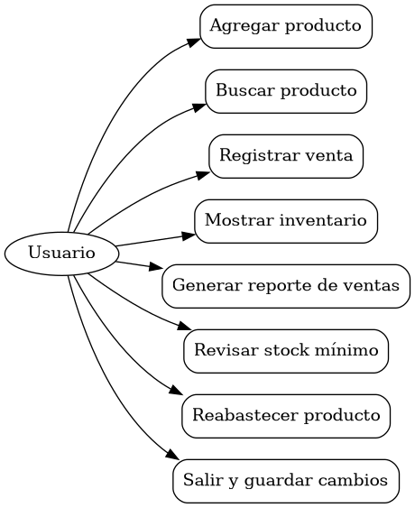
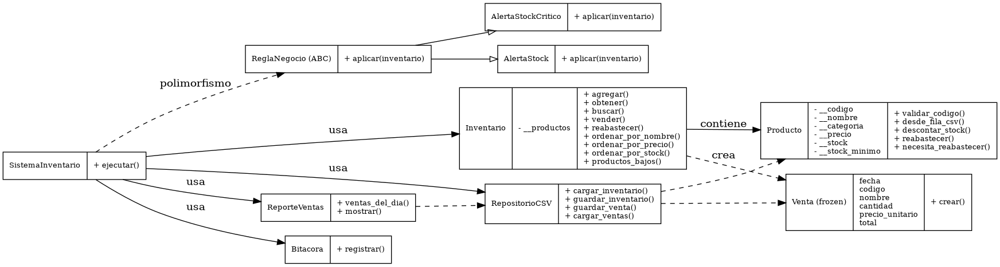
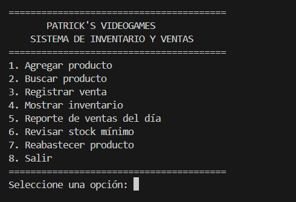
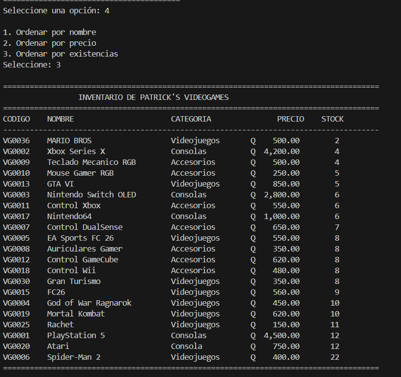
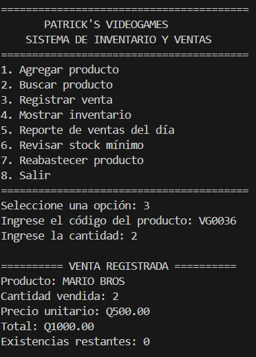
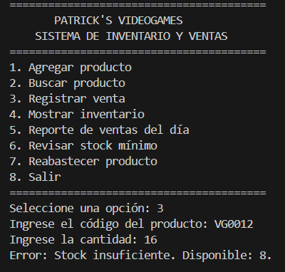

# 🎮 Patrick's VideoGames — Proyecto Final POO

Sistema de inventario y ventas desarrollado en **Python**, realizado como proyecto final de Programación Orientada a Objetos para UMG.

## 👨‍💻 Información del proyecto

- **Proyecto:** Patrick's VideoGames
- **Lenguaje:** Python
- **Paradigma:** Programación Orientada a Objetos (POO)
- **Persistencia:** Archivos CSV
- **Base del proyecto:** Refactorización del Proyecto 1
- **Regla de negocio especial:** Alerta y control de stock mínimo

---

## 🎯 Objetivo

Refactorizar el sistema original de Patrick's VideoGames utilizando Programación Orientada a Objetos, manteniendo las funcionalidades principales del Proyecto 1 y mejorando la organización, validación, persistencia y manejo de errores.

---

## ⚙️ Funcionalidades

El sistema permite:

1. Agregar productos.
2. Buscar productos por código o nombre parcial.
3. Registrar ventas validando el stock disponible.
4. Mostrar el inventario ordenado por:
   - Nombre
   - Precio
   - Existencias
5. Generar el reporte de ventas del día.
6. Revisar productos que necesitan reabastecimiento.
7. Reabastecer productos.
8. Guardar la información utilizando archivos CSV.
9. Mantener una bitácora de operaciones.
10. Manejar errores mediante excepciones personalizadas.

---

## 🧠 Programación Orientada a Objetos aplicada

El proyecto implementa diferentes conceptos de POO:

### Encapsulamiento
Se utilizan atributos privados/protegidos y propiedades para controlar el acceso y validación de los datos.

### Abstracción
Se utiliza una clase abstracta `ReglaNegocio` mediante `ABC` y `@abstractmethod`.

### Herencia
Las clases `AlertaStock` y `AlertaStockCritico` heredan de `ReglaNegocio`.

### Polimorfismo
Las diferentes reglas de negocio implementan el método `aplicar(inventario)` y pueden ejecutarse de forma uniforme.

### Composición y asociación
`SistemaInventario` coordina diferentes objetos del sistema, incluyendo inventario, repositorio, bitácora y reglas de negocio.

### Métodos especiales
Se utilizan métodos especiales como:

- `__str__`
- `__repr__`
- `__len__`
- `__contains__`
- `__iter__`

También se utilizan:

- `@classmethod`
- `@staticmethod`

---

## 📦 Regla de negocio especial

La regla de negocio principal es el **control de stock mínimo**.

Cada producto posee un nivel mínimo de existencias. Cuando el stock actual es menor o igual al mínimo establecido, el sistema identifica que el producto necesita reabastecimiento.

### Ejemplo

Si un producto tiene:

```text
Stock actual: 2
Stock mínimo: 3
```

el sistema determina que necesita reabastecimiento.

Esta regla permite evitar que los productos lleguen a niveles críticos de inventario.

---

## 🗂️ Estructura del proyecto

```text
PROYECTO-PATRICK-S-VIDEOGAMES/
│
├── datos/
│   ├── bitacora.txt
│   ├── inventario.csv
│   └── ventas.csv
│
├── docs/
│   ├── casos_de_uso.dot
│   ├── casos_de_uso.png
│   ├── casos_de_uso.puml
│   ├── diagrama_clases.dot
│   ├── diagrama_clases.png
│   ├── diagrama_clases.puml
│   ├── reflexion.md
│   └── proyecto1_original/
│
├── evidencias/
│   ├── ERROR_STOCK.png
│   ├── INVENTARIO.png
│   ├── MENU_PRINCIPAL.png
│   └── VENTA.png
│
├── inventario/
│   ├── __init__.py
│   ├── app.py
│   ├── excepciones.py
│   ├── inventario.py
│   ├── modelos.py
│   ├── persistencia.py
│   ├── reglas.py
│   └── reportes.py
│
├── .gitignore
├── README.md
└── main.py
```

---

## 📊 Diagrama de casos de uso



Archivo fuente:

- `docs/casos_de_uso.puml`
- `docs/casos_de_uso.dot`

---

## 🏗️ Diagrama de clases



Archivo fuente:

- `docs/diagrama_clases.puml`
- `docs/diagrama_clases.dot`

---

## 🧪 Evidencias de ejecución

Se incluyen evidencias del funcionamiento del sistema:

### Menú principal



### Inventario



### Registro de venta



### Manejo de error por stock insuficiente



---

## ▶️ Ejecución

Para ejecutar el sistema:

```bash
python main.py
```

El proyecto utiliza únicamente la **biblioteca estándar de Python**, por lo que no requiere instalar librerías externas.

---

## 💾 Persistencia de información

La información se almacena mediante archivos:

- `datos/inventario.csv` → productos e inventario.
- `datos/ventas.csv` → ventas registradas.
- `datos/bitacora.txt` → registro de operaciones realizadas.

---

## 🧾 Proyecto 1 original

El proyecto original utilizado como base para la refactorización se encuentra en:

```text
docs/proyecto1_original/
```

Esto permite observar la evolución del sistema desde su primera versión hasta la implementación orientada a objetos.

---

## 📄 Reflexión final

La reflexión sobre el desarrollo del proyecto se encuentra en:

[`docs/reflexion.md`](docs/reflexion.md)

En ella se documentan los principales aprendizajes, dificultades, estructuras utilizadas y experiencia durante la refactorización.

---

## 🚀 Resultado

Patrick's VideoGames permite administrar productos, controlar existencias, registrar ventas, generar reportes y aplicar reglas de negocio utilizando una estructura organizada basada en Programación Orientada a Objetos.